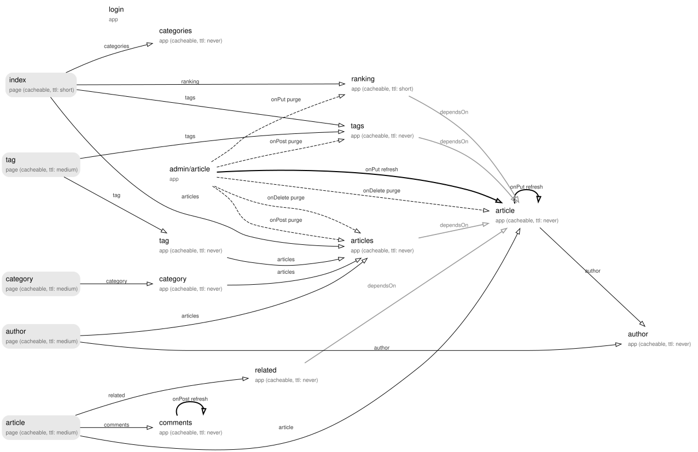

# BEAR.QueryRepositoryGraph

`qr-graph` prints the cache graph that [BEAR.QueryRepository](https://github.com/bearsunday/BEAR.QueryRepository)
attributes declare, without running the application: what each resource embeds, what each write refreshes and
purges, and what an invalidation reaches. It answers "when I write X, which cached resources go stale?" from the
code alone.

## Installation

```bash
composer require --dev bear/query-repository-graph
```

## Usage

Run it from the application root.

```bash
vendor/bin/qr-graph dump                                  # one JSONL line per resource
vendor/bin/qr-graph impact app://self/user --method=onPut  # what the write reaches
vendor/bin/qr-graph dot | dot -Tsvg > graph.svg           # a picture
vendor/bin/qr-graph dot --cached | dot -Tsvg > cached.svg # only cached resources and what they embed
vendor/bin/qr-graph snapshot > qr-graph.snapshot.txt      # every impact, to review as a diff
vendor/bin/qr-graph observe var/log/query-repository      # the semantic log against the declarations
```

`dump` and `impact` are JSONL for tools and AI agents (`jq`, `grep`); `dot` is for the eye; `snapshot` is for
review; `observe` checks what the cache did against what the code declares. The commands, their output and its
limits are described in [docs/graph.md](docs/graph.md); the output
shapes are the JSON Schemas under [docs/schemas/graph](docs/schemas/graph).

## Reading the picture



| | |
|---|---|
| grey rounded box | a `page` resource |
| plain text | any other resource (`app`); a host other than `self` is shown, as in `app://blog` |
| second row | the scheme and the cache as declared: `cacheable, ttl: never`, `cacheable view, ttl: …`, `cacheable response`, `donut cache`; nothing when the resource is not cached |
| solid arrow | embeds, labelled with the relation (`index` embeds `entries` as `entries`) |
| dotted arrow | `#[DependsOn]` |
| bold arrow | a write that refreshes (`onPut refresh`) |
| dashed arrow | a write that purges (`onPost purge`) |
| leftmost column | pages no other resource points to: where a request starts (none in this example: `digest` points to `index`) |

Arrows point the way they are declared. Invalidation travels against them: purging `article` reaches `entries`
through its dotted arrow, and `index` through the solid one.

## Reading the snapshot

```
app://self/article
  app://self/archive (dependsOn)
  app://self/entries (dependsOn)
    page://self/index (embed, cacheable, ttl: never)
  app://self/middle (dependsOn, cacheable, ttl: never)
```

A block reads "invalidating `app://self/article` reaches these". Each line is reached from the line above it at
one less indent, by the relation in parentheses, followed by its cache and, for an embed of a donut page, whether
it is a `material` or a `hole`. Write blocks (`app://self/writer onPost`) start from what the write refreshes and
purges.

Keep the file in the repository and check it in CI:

```bash
vendor/bin/qr-graph snapshot | diff -u qr-graph.snapshot.txt -
```

A pull request that changes what a write invalidates then shows it as a diff of this file.
